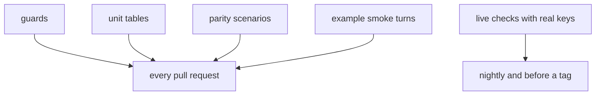

# Tests in unmute-core

A test here proves one of four things:

1. A project that uses the whole library installs and answers a call.
2. A project that uses one piece of the library installs and answers a call.
3. A behaviour on a call is the same on LiveKit and Pipecat.
4. The design rules still hold: the core imports no framework, the version gate works, the framework privates we read are still there.

A test that proves none of these is a candidate to delete.

## The layers



1. **Guards** check the design rules: `tests/test_imports.py`, `tests/test_framework_imports.py`, `tests/test_version.py`, `tests/test_docs.py`, and the SDK pins in `tests/livekit/test_sdk_pins.py` and `tests/pipecat/test_sdk_pins.py`.
2. **Unit tables** cover pure core logic through its public API. One test per behaviour. The inputs sit in a `pytest.mark.parametrize` table.
3. **Parity scenarios** cover what a caller hears or the model sees. One JSON file in `tests/conformance/scenarios/` runs on all six drivers: LiveKit, LiveKit plain, Pipecat, Pipecat voice, and both realtime drivers.
4. **Example smoke turns** run one typed caller line through each hand-written example's own entrypoint, with a scripted model and no network. `scripts/check-examples.sh` runs them in CI. The code is in `tests/examples/`.
5. **Live checks** use real keys. `pytest -m live` runs `tests/live/`. `scripts/check-examples.sh --live` runs the smoke turns with the real model. The `Nightly` workflow runs both. Run it by hand before a release tag.

## Where a new test goes

| The change | Add |
|---|---|
| Something a caller hears or the model sees | a scenario in `tests/conformance/scenarios/` |
| A pure function in the core | a row in the existing table test for it |
| Glue only one framework has (a carrier wire format, a framework hook) | a test in `tests/livekit/` or `tests/pipecat/` |
| A framework private we read | a pin in that framework's `test_sdk_pins.py` |
| A new hand-written example, or a new file in `examples/minimal/` | its module name in `smoke_modules` in `scripts/check-examples.sh` |
| Anything that needs a real provider | a test in `tests/live/` with `pytestmark = pytest.mark.live` that skips when its key is unset |

Look for an existing test first. Add a row or a scenario turn before you add a new test function.

## What not to test

- **What Pydantic already does.** A `Field(ge=1)` rejects 0. A frozen model refuses assignment. A missing field fails. Test a validator only when it is ours and its message names what to fix.
- **Private names.** Test through the public API. One exception: a cache counter that guards the rule "build once, never per turn". It carries a one-line `#` reason.
- **The same behaviour once per adapter.** Write one scenario instead.
- **Exact bytes**, unless a reader depends on them: text the model reads, what a signature covers, what the dev page parses.
- **Constructors and plumbing** that a smoke turn or a scenario already runs.

## How to add a scenario

1. Copy the closest file in `tests/conformance/scenarios/`. Set `name` to the file name and write `about` as one plain sentence.
2. Write the turns: the caller line, the scripted model replies with their `site`, and what is `spoken`.
3. See what each adapter does:
   ```bash
   uv run python -m tests.conformance.show <name>
   ```
4. Read the output. Copy it into `expect` only when it is what the behaviour should be.
5. Run it:
   ```bash
   uv run pytest tests/conformance -k <name>
   ```

A new knob goes into `Scenario` or `Reply` in `tests/conformance/scenario.py`, and into both drivers.

## How a test reads

- The name says the behaviour in plain words: `test_a_refused_tool_says_nothing`.
- Arrange, act, assert, with no comments. Shared setup lives in `tests/tasks/job.py`, `tests/livekit/fake.py` and `tests/pipecat/harness.py`. Reuse them before you write a fake.
- Assert what the caller or the model gets, not how the code got there.
- No sleeps. Wait on a condition with a short timeout.

## How to prune

Delete or merge in one area per commit, so each change is easy to review.

1. Measure first:
   ```bash
   uv run --with pytest-cov pytest --cov=unmute_core --cov-report=json:cov-before.json -q
   ```
2. Pick a candidate: a Pydantic re-test, a read of a private name, a test that a scenario repeats, or several tests that differ only in input.
3. For a test a scenario repeats, open the scenario and check that it asserts the same thing. If not, add the missing turn to the scenario first.
4. Merge near-duplicates into one table. Keep every input as a row.
5. Measure again, and compare the missed lines per file. A line that only the deleted test reached needs a reason: dead code (delete it too) or a Pydantic re-test.
6. Break the behaviour on purpose and check that a remaining test fails.

## Commands

```bash
uv run pytest                              # every pull-request layer except the examples
scripts/check-examples.sh                  # install, import and one smoke turn per example
scripts/check-examples.sh examples/minimal/livekit
uv run pytest -m live                      # needs keys, see each file's docstring
scripts/check-examples.sh --live examples/parcel-desk/pipecat
```
