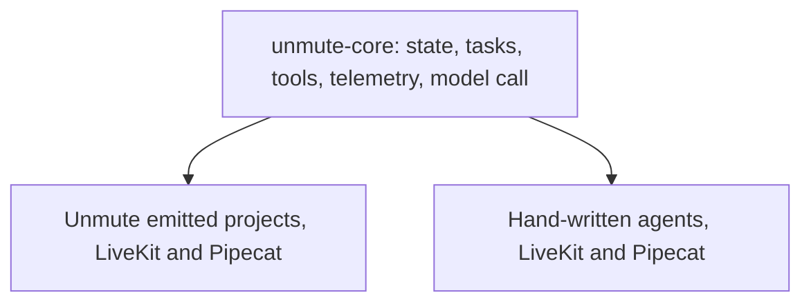

# unmute-core

`unmute-core` is the Python library that holds the voice-agent behaviour that must be the same everywhere. Unmute's emitted projects import it. Hand-written LiveKit and Pipecat agents can import it too. A fix lands here once and reaches every agent.



1. The core holds framework-neutral code. It never imports LiveKit or Pipecat.
2. `unmute_core.livekit` and `unmute_core.pipecat` hold the adapters. Users get them with the `[livekit]` or `[pipecat]` extra.
3. Plug points (`ModelCall`, `ToolExecutor`, telemetry sinks, hooks) let other code add a capability without changing the library.

`local/` holds files for local development only. Git ignores it, and `.worktreeinclude` copies it into worktrees. If `local/REPO_MAP.md` exists, read it first.

## Decisions already made
- Name: distribution `unmute-core`, import `unmute_core`, repo `slng-ai/unmute-core`.
- Python `>=3.12`. Develop on 3.12 (`.python-version`) so newer syntax fails here first.
- One package with `[livekit]` and `[pipecat]` extras. Both frameworks are on their newest release: LiveKit `>=1.8.8,<1.9`, Pipecat `>=1.12.0,<1.13`. The core's own floors are as low as `scripts/check-floors.sh` proves: OpenTelemetry `>=1.40`, pydantic `>=2.11`, openai `>=1.109,<4` (the `slng` extra). LiveKit 1.8.8 brings OpenTelemetry 1.45 and openai 3 itself. The library leads and Unmute's `internal/target/driver.go` follows. Unmute moves to the same pins in slng-ai/unmute#301.
- Install from PyPI: `uv add "unmute-core[livekit]"`. A `v*` tag publishes to TestPyPI, then to PyPI after a maintainer approves, with trusted publishing. `.github/workflows/release.yml` runs CI and the live tests first.
- Unmute's constitution rule "no runtime dependency" (Principle I) will be changed in the Unmute repo.
- Datadog is a public telemetry target: spans go over OTLP to an OpenTelemetry Collector that exports to Datadog. It is built here first, then added to Unmute.
- Prefetch and knowledge are library classes too, so any agent can use them.
- **The library is standalone.** It never reads `agent.yaml` and never builds the pipeline. Unmute's emitted code or a hand-written `agent.py` builds the pipeline and calls the library.
- **Native and SLNG providers.** Everything works with native framework plugins and no SLNG package. SLNG support sits behind a `[slng]` extra. STT and TTS (native or `livekit-plugins-slng` / `pipecat-slng`) stay with the framework plugins. The library only reads their metrics. The model call has two implementations: native (the library fills the prompt) and the SLNG Context Router (headers, prompt site, `template_variables`, router retry rules). SLNG may add capabilities. It must not change what the agent does: the model sees the same final prompt on both paths.

## Rules that hold the design together
- **A plug point may add a capability. It must never change how the rest of the library behaves.**
- **The core imports no framework.** Only `unmute_core/livekit/` imports `livekit`, and only `unmute_core/pipecat/` imports `pipecat`. A test enforces this.
- **One plug point for the model call.** Every model request goes through one small interface, `unmute_core.model.ModelCall`. Another runner can replace it later.
- **The library refuses generated code that is newer than itself.** Emitted code states the library version it needs. Import fails with a clear message, at deploy time, not during a call.
- **Same behaviour on both frameworks is proven by shared test data.** A behaviour change adds a case that both adapters run.
- **`unmute_core.state` works on any Pydantic model.** An Unmute author's `State` class and a model `StateSchema` builds from type text (`Phone | None`, `list[Contact]`) run through the same `CallState`. The type grammar is plain Python type text that Unmute and any agent defined as data share, so it lives here. A value type the library ships, like `Phone`, declares a JSON Schema `format` so other tools can name it.

## Python style
Follow the `python-dev` skill. In addition:
- **Classes when they own state or form a plug point.** Examples: `CallState`, a task step, a telemetry sink. Plain functions for pure transformations. No interface with only one implementation, except the declared plug points.
- **Comprehensions over loops that build a collection.** Ruff `PERF401` and `C4` enforce it. Keep a `for` loop when the body awaits, does I/O, or needs several branches.
- **The library is Pydantic-native.** Every value object, config, spec, event, record and result is Pydantic. Read the `pydantic` skill before you write one.
  - A value class is a `pydantic.dataclasses.dataclass` with `config=VALUE`, wrapped in `@original_errors` (both from `unmute_core._pydantic`). Positional arguments, `dataclasses.replace` and user subclasses keep working. Use `frozen=True` when nothing changes it after it is built.
  - A record that replaces a dict is a private `BaseModel` with `ConfigDict(frozen=True, extra="forbid")`, dumped to the same dict.
  - A class stays plain only when the framework owns it, it owns mutable runtime state or asyncio objects, or it runs per audio frame.
- **Every check is a constraint or a validator.** Use `Field(ge=, le=, pattern=, max_length=)`, `StringConstraints` and `Annotated[..., AfterValidator(...)]` on the field. Use `model_validator(mode="after")` only for rules across fields. A hand-written `if ...: raise` stays only when the check needs runtime state or another object. It carries a one-line `#` reason.
- **Errors keep their type and text.** `@original_errors` hands the caller the error our own validator raised, like `ParameterSchemaError`, and turns an argument mistake into `TypeError`. A built-in constraint raises `ValidationError`, which is a `ValueError`.
- **Fields that carry wire data or framework objects use `SkipValidation[...]`.** Chat messages, tool schemas, executors, sessions, spans. They keep their identity and cost nothing. A Protocol-typed field needs it, or the class fails to build.
- **Only `unmute_core.settings` reads the environment.** Add a field to an `EnvSettings` class. A variable whose name comes from config goes through `env_value(name, type)`.
- **Keep the bytes when a reader depends on them.** Text a model reads, a signature covers or the dev page parses stays `json.dumps(model.model_dump(mode="json"), ...)` with today's options.
- **Measure the hot path.** `scripts/time-turns.py` times one turn on each driver. A change that adds more than 5% per turn stays plain and is listed in the `specs/` notes.
- **Pick the structure for the access.** Membership on `set` or `frozenset`. A lookup repeated per turn uses a dict built once. Queues are `deque`, counts are `Counter`. Constants are `frozenset`, `tuple` or `MappingProxyType`. Build schemas, `TypeAdapter`s and `create_model` classes once, never per turn. Never cache by a type built per call: the cache keeps every one alive.
- **No private reads across classes.** Add a public property or method on the owner. A framework private gets a pin test in `tests/livekit/test_sdk_pins.py` or `tests/pipecat/test_sdk_pins.py`. Core packages may import each other's private modules, to avoid import cycles.
- **Framework-neutral code lives in the core**, even when only the adapters call it. When both adapters do the same thing, they call one core function. Where the frameworks differ, the core function takes a flag.
- **Split a function over about 60 lines or a class with several jobs.** The public class stays as the facade and delegates to classes that own their own state.
- **No `from __future__ import annotations`** in modules that define Pydantic models.
- Type hints everywhere. Google docstrings. Specific exceptions. Errors that name what to fix.
- **Docstrings explain definitions. `#` is for inline comments only.** Every class and function in `src/` gets a docstring. Tests are exempt: a test's name says what it checks. Never put a `#` comment block above a definition. Write code that explains itself through its names, so inline comments stay rare.
- **No new dependency for what a few lines of stdlib do.** Justify each new one in the PR.

## Commands
```bash
uv sync --all-extras                 # dev env with both frameworks
uv run pytest                        # tests
scripts/check-examples.sh            # each example installs, imports and answers one turn
uv run ruff check . && uv run ruff format --check .
uvx ty check                         # types (not mypy, not pyright)
uv run python scripts/time-turns.py  # CPU per call turn, each adapter
```

## Tests
Read the `unmute-tests` skill before you add, change or delete a test. In short:
- A behaviour a caller hears or the model sees is a JSON scenario in `tests/conformance/scenarios/`. Both adapters run it.
- Core logic gets a row in an existing table test, through the public API.
- Each hand-written example answers one scripted turn in CI. Real keys run only in the `Nightly` workflow and before a release tag (`pytest -m live`).
- Never re-test what Pydantic does, a private name, or one behaviour once per adapter.
- Test only what a real call can meet. Name that call in the scenario's `about`.
- A wait waits for the thing itself, never for time or quiet. A test that failed once in CI has a race: find it, do not rerun.

## Porting code
- Port the tests with the code. A port without its tests is not done.
- Describe the behaviour. Cite only public repos, as `<repo>@<short sha> path:line`.
- Framework source is in `.venv/lib/python3.12/site-packages/{livekit,pipecat}` after `uv sync --all-extras`. Read it there before you guess an API.

## Workflow
- Plan before editing. Use plan mode. Notes and the written plan go in `specs/<nnn>-<slug>/`, which git ignores.
- One session, one branch, one PR. Use a worktree when sessions run in parallel.
- Delegate bounded read-only work to subagents in parallel: exploring reference code, reading docs, reviewing. Never let two agents edit the same files.
- Skills: `unmute-tests`, `python-dev`, `pydantic`, `ponytail`, `find-docs` (for any library question), `livekit-agents`, `langfuse`.
