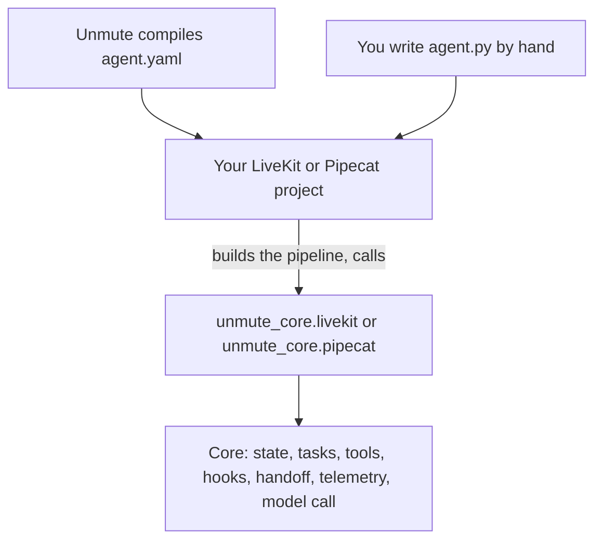

# unmute-core

[](https://pypi.org/project/unmute-core/)
[](https://pypi.org/project/unmute-core/)
[](https://github.com/slng-ai/unmute-core/actions/workflows/ci.yml)
[](https://github.com/slng-ai/unmute-core/blob/main/LICENSE)

unmute-core is a Python library for voice agents on [LiveKit Agents](https://github.com/livekit/agents) and [Pipecat](https://github.com/pipecat-ai/pipecat). You keep your framework, your speech and model plugins, and your pipeline. The library adds what a real phone or web call needs on top: typed call state, task steps, tools, handoffs, idle callers, transfers and tracing.

[Unmute](https://github.com/slng-ai/unmute) compiles an agent spec into a LiveKit or Pipecat project. Those projects import this library. You can also use it in an agent you write by hand, one piece at a time or all of it.

## Example

A plain LiveKit agent with one tool from the library:

```python
import os

from livekit.agents import Agent, AgentSession
from livekit.plugins import openai, silero, slng
from pydantic import BaseModel

from unmute_core.livekit import function_tools
from unmute_core.tools import ToolRegistry, local_tool


class OrderStatus(BaseModel):
    order_id: str
    status: str


def order_status(order_id: str) -> OrderStatus:
    """Look up an order by its id. The return annotation is the result's checked shape."""
    return OrderStatus(order_id=order_id, status="out for delivery")


registry = ToolRegistry([local_tool(order_status, announce="One moment, let me check.")])

agent = Agent(instructions="You help with orders.", tools=function_tools(registry))
slng_host = f"{os.environ['SLNG_WORLD_PART']}.api.slng.ai"
stt = slng.STT(slng_base_url=slng_host, model="soniox/speech-ai:rt-v5")
session = AgentSession(
    stt=stt,
    llm=openai.LLM(),
    tts=slng.TTS(
        slng_base_url=slng_host,
        model="slng/fish/tts:s2.1-pro",
        voice="8d8aec63a56c460cb7def795bdf754fa",
    ),
    vad=silero.VAD.load(),
)
stt.attach_to_session(session)
```

The agent stays a normal LiveKit `Agent`. The library adds the tool and the line the agent says while the tool runs. Speech runs on SLNG: Soniox hears the caller and Fish Audio speaks, with your `SLNG_API_KEY`. On Pipecat, put `tools_schema(registry)` on the `LLMContext` instead.

## How it fits



1. Your project builds the pipeline. Unmute writes that project for you, or you write it yourself.
2. The project calls an adapter: `unmute_core.livekit` or `unmute_core.pipecat`.
3. The adapter turns framework events into calls to the core. The core never imports LiveKit or Pipecat.
4. The same core runs on both frameworks. Shared test scenarios run on both adapters and must give the same result.

The library never reads `agent.yaml` and never builds the pipeline. Your speech-to-text, text-to-speech and LLM plugins stay yours.

## Three ways to use it

| Way | What you write | Start here |
|---|---|---|
| One piece at a time | A plain `Agent` or pipeline, plus the pieces you want: tools, greeting, idle nudges, tracing | [standalone](https://github.com/slng-ai/unmute-core/blob/main/docs/core/frameworks/standalone.mdx), [examples/minimal](https://github.com/slng-ai/unmute-core/tree/main/examples/minimal) |
| A whole agent | One `AgentSpec` with typed state, tasks and handoffs, run by `UnmuteAgent` on LiveKit or `UnmuteFlows` on Pipecat | [livekit](https://github.com/slng-ai/unmute-core/blob/main/docs/core/frameworks/livekit.mdx), [pipecat](https://github.com/slng-ai/unmute-core/blob/main/docs/core/frameworks/pipecat.mdx), [examples/salon-concierge-unmute](https://github.com/slng-ai/unmute-core/tree/main/examples/salon-concierge-unmute) |
| Compiled by Unmute | `agent.yaml` and Markdown prompts. Unmute writes the Python. | [Unmute](https://github.com/slng-ai/unmute), [examples/salon-concierge](https://github.com/slng-ai/unmute-core/tree/main/examples/salon-concierge) |

An agent can also be defined as data: state as type text like `Phone | None`, tasks and tools as JSON. See [examples/parcel-desk](https://github.com/slng-ai/unmute-core/tree/main/examples/parcel-desk).

Four whole agents show other shapes of call, each on LiveKit and Pipecat from one package, on SLNG speech and Gemini in the EU: a restaurant finder with tools only ([nosh](https://github.com/slng-ai/unmute-core/tree/main/examples/nosh)), a car claim intake ([kestrel](https://github.com/slng-ai/unmute-core/tree/main/examples/kestrel)), an outbound payment reminder ([wasla](https://github.com/slng-ai/unmute-core/tree/main/examples/wasla)) and a bilingual language tutor ([faro](https://github.com/slng-ai/unmute-core/tree/main/examples/faro)). See [example agents](https://github.com/slng-ai/unmute-core/blob/main/docs/core/examples/overview.mdx) and [type the path](https://github.com/slng-ai/unmute-core/blob/main/docs/core/examples/typed-path.mdx).

## Why use it

LiveKit and Pipecat move audio, run the models and call your tools. They do not decide what a good phone call looks like. Every team learns that from its first real calls. unmute-core holds what we learned, so you start from it.

1. **One agent, two frameworks.** State, tasks, tools, prompts and traces run the same on LiveKit and Pipecat. 90 test scenarios run on both frameworks, with plain and realtime models, and must give the same result.
2. **The model cannot break your data.** Each value the model saves is checked against its type. A wrong value is refused with a reason the model can act on, like `caller_phone: expected a phone number with its country code`. The model asks the caller again.
3. **Over 100 call optimizations, built in.** Some examples:

| On a call without it | What unmute-core does |
|---|---|
| A weak model says "Noted, thank you" and never finishes the step. | The finish check asks the model one narrow question: finish, or not yet. |
| The caller pauses, goes on, and the reply plays over them. | `yield_to_caller` drops that reply. The next one answers everything they said. |
| A slow tool leaves the caller in silence. | The tool says a line as it starts, and the caller's voice never cancels it. |
| A tool returns the wrong shape, and the model tells the caller it worked. | Every tool names the Pydantic model of its result. A result that does not fit fails the call, and the model reads which field is wrong. |
| The new agent hands the call straight back after a handoff. | Handoff tools are hidden on the first reply after a handoff. |
| A bad key is tried on every fallback model while the caller waits. | Errors that every model would give stop the fallback chain at once. |
| Gemini 3 refuses the next request after a tool call. | Thought signatures are kept on replayed tool calls. |
| The model or voice fails and the caller hears silence. | A short apology plays, then the call ends with a clear reason. |
| A webhook tool reaches `localhost` or a cloud metadata address. | Each webhook address must be public, and the connection is pinned to it. |
| Each framework traces differently, so dashboards break when you switch. | One trace shape on both, sent to Langfuse, Coval, Logfire or any OpenTelemetry collector. |

[Why unmute-core](https://github.com/slng-ai/unmute-core/blob/main/docs/core/start/why-unmute-core.mdx) follows one call from start to end. Each feature page then starts with what it fixes.

## Install

Python 3.12 or newer. Pick the extra for your framework:

```bash
uv add "unmute-core[livekit]"
```

```bash
uv add "unmute-core[pipecat]"
```

| Extra | What it adds |
|---|---|
| `livekit` | The LiveKit adapter. LiveKit Agents 1.8.8 or newer within 1.8. |
| `pipecat` | The Pipecat adapter. Pipecat 1.12 or newer within 1.12. |
| `slng` | The `openai` package, for `OpenAIModelCall` and the SLNG Context Router as a model call. See [slng](https://github.com/slng-ai/unmute-core/blob/main/docs/core/models/slng.mdx). |
| `knowledge` | Search over a folder of documents, with llama-index. See [knowledge](https://github.com/slng-ai/unmute-core/blob/main/docs/core/build/knowledge.mdx). |

Everything works with your framework's own plugins and no SLNG package. [installation](https://github.com/slng-ai/unmute-core/blob/main/docs/core/start/installation.mdx) covers version ranges and the version check at import.

## Simulate calls

A scripted test proves one path. To measure a change to a prompt, a model or the runtime, you need many calls and their statistics. The call simulator gives you both: model callers ring an agent, and every call is checked.

```bash
export SIMULATE_BASE_URL=https://generativelanguage.googleapis.com/v1beta/openai/ SIMULATE_API_KEY=...
python -m unmute_core.testing scenarios
python -m unmute_core.testing simulate livekit --calls 10 --agent-model gemini-3.1-flash-lite \
    --caller-model gemini-3.5-flash --judge-model gemini-3.8-flash --out runs/before
python -m unmute_core.testing report runs/after --compare runs/before
python -m unmute_core.testing parity runs/livekit runs/pipecat
```

How a run works:

1. **A caller with a script.** The caller is a model with a persona, a goal, the only facts it may give and the moves it makes, in order. It hangs up by writing `[HANGUP]`. The agent is a real `UnmuteAgent` or `UnmuteFlows` in a text-only session. Its tools answer from deterministic mocks, so a check knows what each tool returned. 32 scenarios ship, on 11 agents for made-up businesses.
2. **Checks code can make.** The values saved match the scenario. No saved value is one the caller never gave. A step saves only after the caller spoke in it. Each task's run record matches its task events. The call ended naturally, and what the scenario requires happened on the way.
3. **Checks only a reader can make.** A judge model reads the transcript with every event the caller cannot hear in place: task starts and ends, each save and what made it, each tool result. It rules on eight questions: seven about the agent, like whether it claimed a booking before it was saved, and one about the caller.
4. **Only calls that say something about the agent are scored.** A call is left out of every pass rate, counted apart and named, when the agent's endpoint failed (a rate limit, a 5xx or a timeout that lasted through the retries), when the simulator itself broke, when the judge gave no verdict, or when the simulated caller left its script: it gave a number, date or service its facts do not hold, or did the opposite of a move. The judge rules on the caller too. A saved value the caller made up is `caller_off_script_value`, not `fabricated_value`. A request the endpoint refused as invalid is the agent's error, and fails the call.
5. **Numbers you can compare.** `report --compare` sets two runs side by side, with a Fisher exact test per check, so a change seen in a handful of calls is not read as a trend. `parity` pairs the calls of a LiveKit run and a Pipecat run of the same scenarios.
6. **A gate for CI.** `--gate` fails the run when a planned call has no result, when fewer than 75% of the planned calls are scored (so a broken environment never passes), or when the scored calls' pass rate is below `--gate-min-pass`. `--retry-failed N` runs failed calls again, keeps the earlier attempts, and reports a call that passed only on a retry as flaky.

The agent, the caller and the judge each run on any OpenAI-compatible endpoint. Run the caller and the judge on a different model from the agent. [Testing](https://github.com/slng-ai/unmute-core/blob/main/docs/core/reference/testing.mdx) lists every flag and variable.

## Docs

The docs tell one story. Start small, then go deeper where you need to.

1. **Get started:** [why unmute-core](https://github.com/slng-ai/unmute-core/blob/main/docs/core/start/why-unmute-core.mdx), [installation](https://github.com/slng-ai/unmute-core/blob/main/docs/core/start/installation.mdx) and the [quickstart](https://github.com/slng-ai/unmute-core/blob/main/docs/core/start/quickstart.mdx).
2. **Build a salon agent:** a [tutorial](https://github.com/slng-ai/unmute-core/blob/main/docs/core/tutorial/overview.mdx) that grows one agent, one piece per page. It ends at [examples/salon-concierge-unmute](https://github.com/slng-ai/unmute-core/tree/main/examples/salon-concierge-unmute).
3. **On your framework:** [add one piece to your agent](https://github.com/slng-ai/unmute-core/blob/main/docs/core/frameworks/standalone.mdx), or run a whole agent on [LiveKit](https://github.com/slng-ai/unmute-core/blob/main/docs/core/frameworks/livekit.mdx) or [Pipecat](https://github.com/slng-ai/unmute-core/blob/main/docs/core/frameworks/pipecat.mdx).
4. **Guides:** [state](https://github.com/slng-ai/unmute-core/blob/main/docs/core/build/state.mdx), [tools](https://github.com/slng-ai/unmute-core/blob/main/docs/core/build/tools.mdx), [knowledge](https://github.com/slng-ai/unmute-core/blob/main/docs/core/build/knowledge.mdx), [tasks](https://github.com/slng-ai/unmute-core/blob/main/docs/core/build/tasks.mdx), [handoffs](https://github.com/slng-ai/unmute-core/blob/main/docs/core/build/handoffs.mdx), [call lifecycle](https://github.com/slng-ai/unmute-core/blob/main/docs/core/build/call-lifecycle.mdx), [prefetch](https://github.com/slng-ai/unmute-core/blob/main/docs/core/build/prefetch.mdx), [turn taking](https://github.com/slng-ai/unmute-core/blob/main/docs/core/build/turn-taking.mdx), [hooks](https://github.com/slng-ai/unmute-core/blob/main/docs/core/build/hooks.mdx), [model call](https://github.com/slng-ai/unmute-core/blob/main/docs/core/models/model-call.mdx), [slng](https://github.com/slng-ai/unmute-core/blob/main/docs/core/models/slng.mdx), [realtime](https://github.com/slng-ai/unmute-core/blob/main/docs/core/models/realtime.mdx), [telephony](https://github.com/slng-ai/unmute-core/blob/main/docs/core/telephony.mdx) and [telemetry](https://github.com/slng-ai/unmute-core/blob/main/docs/core/observe/telemetry.mdx).
5. **Example agents:** [overview](https://github.com/slng-ai/unmute-core/blob/main/docs/core/examples/overview.mdx), [type the path](https://github.com/slng-ai/unmute-core/blob/main/docs/core/examples/typed-path.mdx), and one page each for [nosh](https://github.com/slng-ai/unmute-core/blob/main/docs/core/examples/nosh.mdx), [kestrel](https://github.com/slng-ai/unmute-core/blob/main/docs/core/examples/kestrel.mdx), [wasla](https://github.com/slng-ai/unmute-core/blob/main/docs/core/examples/wasla.mdx) and [faro](https://github.com/slng-ai/unmute-core/blob/main/docs/core/examples/faro.mdx).
6. **Reference:** [settings](https://github.com/slng-ai/unmute-core/blob/main/docs/core/reference/settings.mdx), [tasks](https://github.com/slng-ai/unmute-core/blob/main/docs/core/reference/tasks.mdx) and [testing](https://github.com/slng-ai/unmute-core/blob/main/docs/core/reference/testing.mdx).

## Versions

The library is 0.x. Code written for `0.14.x` runs on any later `0.14.x`. A new minor version, like `0.15.0`, may break it. `unmute_core.require()` checks this when your code imports.

[CHANGELOG.md](https://github.com/slng-ai/unmute-core/blob/main/CHANGELOG.md) lists what each release changed, and what can break you first.

## Develop

```bash
uv sync --all-extras
uv run pytest
uv run ruff check . && uv run ruff format --check .
uvx ty check
```

[CONTRIBUTING.md](https://github.com/slng-ai/unmute-core/blob/main/CONTRIBUTING.md) explains how to send a change. [SECURITY.md](https://github.com/slng-ai/unmute-core/blob/main/SECURITY.md) explains how to report a security problem.

## License

MIT. See [LICENSE](https://github.com/slng-ai/unmute-core/blob/main/LICENSE).
