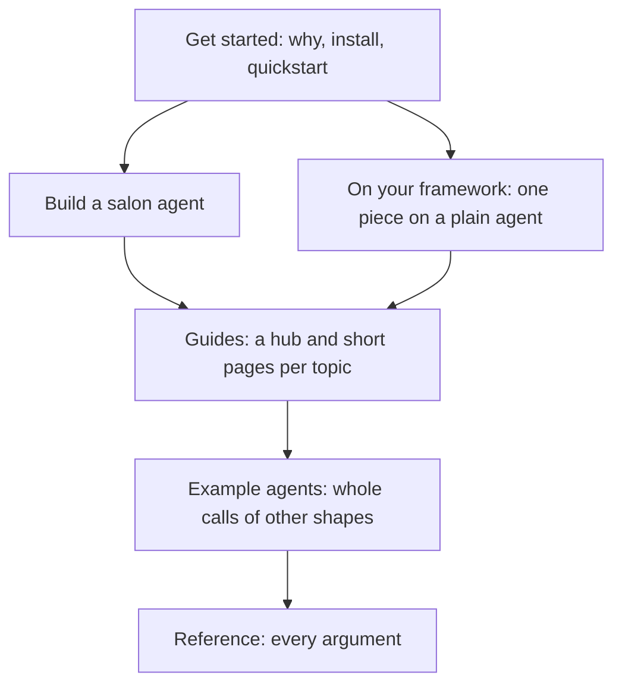

# docs

The unmute-core user docs, as a Mintlify fragment. They become the
"unmute-core" tab of the Unmute site (`slng-ai/unmute`, `docs-site/`).

This file is for contributors. It is not part of the site.

## Preview it

```bash
cd docs
mint dev --no-open                       # serves http://localhost:3000
mint validate
mint broken-links --check-anchors
uv run pytest tests/test_docs.py         # from the repo root
```

`broken-links` reports the links into the Unmute tab, such as `/build/prefetch`
or `/reference/agent-yaml`. Those resolve only on the Unmute site. Any other
broken link is real.

## How it is laid out

```text
docs/docs.json     preview config; its one tab is what Unmute's docs.json gets
docs/core/         every page, at the same path it has on the Unmute site
```

Links between pages are site paths, like `/core/build/state`. They work here
and on the Unmute site without a change.

## Publish to the Unmute site

1. Copy `docs/core/` to `docs-site/core/` in `slng-ai/unmute`.
2. Copy the `unmute-core` entry of `navigation.tabs` from `docs/docs.json` into
   Unmute's `docs-site/docs.json`, after the Unmute tab.
3. Run `make docs` in Unmute. Its tests check every page here too.

The library's names win. Unmute imports them, so a page uses the real name
even when an Unmute word list refuses it. Example: Unmute's
`internal/skill/agreement_test.go` refuses the retired word "delegate", but
`reference/dev-records.mdx` names the real method `CallTasks.delegate_tools()`.
That test exempts `docs-site/core/` instead.

`start/unmute-and-core.mdx` describes Unmute's emitted code once it imports
the library. Publish it only after that Unmute change has merged.

## The rules

These are the Unmute site's rules. Its tests refuse a page that breaks them.

1. **Every fact is checked against `src/unmute_core` before it is written.**
   Signatures, defaults, field names, error messages.
2. **Plain language.** Short sentences, under 40 words. No em or en dashes.
3. **No version numbers.** No `v1.2.3` tag and no framework pin. Write
   `vX.Y.Z` in an install snippet, and point at the changelog.
4. **The page states what the library does.** How a fact was checked goes in
   the PR, not on the page.
5. **One home per topic.** A second page links to it and does not repeat it.
6. **Built-in components first.** `ParamField`, `Accordion`, `Steps`,
   `CodeGroup`, `Card`. A custom React component goes through the `impeccable`
   skill.
7. **A title is unique on the whole Unmute site.** When an Unmute page has the
   same name, write the title as "Tasks in code" and keep `sidebarTitle: "Tasks"`.
8. **A `type` is written in double quotes.** Allowed values read
   `type="cold | warm"`, the way Unmute writes them, not `Literal[...]`.
9. **Two model ids only.** Examples name `gpt-5.6-terra` or `gpt-5.6-luna`, the ids
   Unmute's scaffold owns. Unmute's tests refuse any other `gpt-...` id.
10. **The router cache is never promised.** A page that says "cache" also says the
    router judges which turns are repeatable. A page that lists the router's
    upstreams says which were validated live.
11. **A `path` is a name.** For a method, write `path="tool_ended" type="method"`
    and put the signature in the text. An `=` inside `path` breaks MDX.
12. **MDX must parse.** Write `cols={2}`, not `cols=2`. A closing tag of an
   element with a blank line inside starts its own line.

## The story the docs tell

The nav order is the story. A reader starts small and meets each idea once,
when they need it.



1. **Get started** says what the library is and runs the smallest agent.
2. **Build a salon agent** grows one agent, one piece per page. Its code comes
   from `examples/salon-concierge-unmute`, with the same names.
3. **On your framework** is the side track for a plain LiveKit `Agent` or
   Pipecat pipeline. The setup on each kind of agent lives only here.
4. **Guides** go deeper on one topic. Use salon names in examples.
5. **Example agents** are whole agents from `examples/kestrel`, `wasla`, `nosh`
   and `faro`, one page each. Their code is quoted from those projects, with the
   same names. Change the page when the example changes.
6. **Reference** holds every argument. Guides link to it and do not repeat it.

## The shape of a page

There are four kinds of page. Each skips what it does not need. No page has a
hand-written "On this page" list: Mintlify shows its own.

**Tutorial page** (`core/tutorial/`, 80 to 180 lines):

1. "You have: ..." with a link to the page before.
2. The goal in one sentence, in caller terms.
3. Only the code this step adds, with the file name on each fence.
4. **Try it**: what to say on the call, and what you should hear.
5. **Why it works this way**: two to four sentences.
6. **What you have now**: a short table of the pieces so far.
7. A card to the next page, and a "Go deeper" link to the guide.

**Hub page** (a topic's root, such as `build/tasks.mdx`, under 120 lines):

1. A one-sentence definition, and "Use it when" bullets.
2. One diagram, and a table for choosing between options when there are some.
3. **What it handles for you**: what goes wrong on a call without it, what the
   library does, and a link to the page that explains it.
4. **In this section**: a card per page in the topic.

**Guide page** (`build/<topic>/<page>.mdx`, 100 to 220 lines):

| Slot | What goes in it |
|---|---|
| Definition | one sentence saying what the thing is |
| Code | the smallest code that does the job, before any prose |
| Why use unmute for this | two to four plain sentences, when it adds something |
| The parts | one H2 per idea. A feature ends with **Why it works this way.**, **Best practice.** and, only when the frameworks differ, **On each framework.** |
| Troubleshooting | the symptoms of this page only. H3 per symptom, then **Fix:** and code |
| Footer | "In the salon tutorial" link, "Every argument" link, then `<CardGroup cols={2}>` with the next page first |

**Reference page** (`reference/<topic>.mdx`): one H2 per class, one line on
what it is, a link to its guide, then its `<ParamField>` list.

Arguments are always a `<ParamField>` list under a heading named after the class:

```mdx
## Prefetch

<ParamField path="entries" type="Sequence[Clock | CallValue | Lookup]" required>
  The entries, run in order.
</ParamField>
<ParamField path="budget" type="float" default="2.0">
  Seconds the whole block may take.
</ParamField>
```

`path` first, then `type` as Python type text, then `required` or `default`.
Where code differs by framework, show it in one `<CodeGroup>` with a LiveKit
and a Pipecat block.
