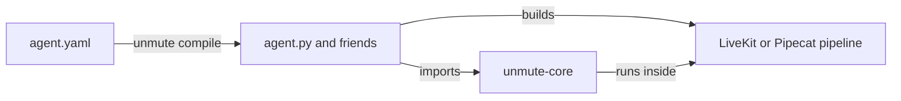

Unmute compiles your package into a Python project. That project imports
unmute-core to run the call.

On this page:

- [From your package to a call](#from-your-package-to-a-call) - who does what, and when
- [Which key becomes which class](#which-key-becomes-which-class) - the full mapping
- [The version gate](#the-version-gate) - why a mismatch fails the deploy
- [Change the generated code](#change-the-generated-code) - what you can edit, and where
- [Where to go next](#where-to-go-next) - the pages behind each class

## From your package to a call



1. `unmute compile` reads your package once, ahead of time. It writes a normal
   Python project for LiveKit or Pipecat.
2. The generated `agent.py` builds the pipeline: speech to text, the model,
   text to speech and turn detection. These stay framework plugins.
3. The generated code builds library objects from what you declared: the
   state, the tasks, the tools. It describes each agent as one `AgentSpec`, the
   same on both frameworks, and runs it with `UnmuteAgent` or `UnmuteFlows`.
4. During the call, the library saves values, runs tools, steps through tasks
   and sends spans. Unmute itself is not in the call path.

A hand-written agent does steps 2 and 3 itself. Everything after that is the
same code.

## Which key becomes which class

| `agent.yaml` key | Library class or function | Page |
|---|---|---|
| `agents`, one per agent: its name, `instructions`, `tools`, `tasks` and `handoffs` | `AgentSpec`, run by `UnmuteAgent` or `UnmuteFlows` | [AgentSpec](/core/reference/agent-spec) |
| `agents.<name>.think` | `AgentSpec(model=...)`, built from the `models.think` entry it names | [Model call](/core/models/model-call) |
| `agents.<name>.speak` | not the library: your text to speech plugin, like SLNG's Fish Audio voice. The library only switches voices when a second agent takes the call | [SLNG speech](/core/models/slng#speech-only) |
| `variables` and `state.py` | `CallState` | [State](/core/build/state) |
| `prefetch` | `Prefetch`, `Clock`, `CallValue`, `Lookup` | [Prefetch](/core/build/prefetch) |
| `tools` | `ToolRegistry`, `local_tool`, `webhook_tool` | [Tools](/core/build/tools) |
| `knowledge` | `KnowledgeBase` | [Knowledge](/core/build/knowledge) |
| `tasks` | `TaskSpec`, `TaskPlan` | [Tasks](/core/build/tasks) |
| `task_groups` | `TaskGroupSpec` | [Tasks](/core/build/tasks) |
| `handoffs` | `HandoffContext`, the `hand_off` method | [Handoffs](/core/build/handoffs) |
| `escalations` | `Transfer` | [Phone calls](/core/telephony) |
| `conversation` | `Greeting`, `IdleNudges` | [The call's life](/core/build/call-lifecycle) |
| `models.turn.*.pace` | `TurnPace`, `turn_window` | [Turn taking](/core/build/turn-taking) |
| `models.think.*.prompt_suffix` | `PromptSuffix` | [Hooks](/core/build/hooks) |
| `models.think` with `provider: slng` | `RouterModelCall` | [SLNG](/core/models/slng) |
| `models.think` with another provider | the framework's own LLM plugin | [Model call](/core/models/model-call) |
| `tracing` | `Langfuse`, `Logfire`, `Coval` | [Telemetry](/core/observe/telemetry) |

The keys are documented on the Unmute side, in the
[`agent.yaml` reference](/reference/agent-yaml). The pages here document what
the class does during the call.

## The version gate

The generated project names the library version it was built for:

```python agent.py
import unmute_core

unmute_core.require("0.4.0")
```

`require()` runs at import. It accepts any installed version with the same
breaking part that is not older. Before 1.0, the breaking part is `0.MINOR`.

| Installed | Generated for | Result |
|---|---|---|
| `0.4.2` | `0.4.0` | runs |
| `0.4.0` | `0.4.2` | `IncompatibleVersionError` |
| `0.5.0` | `0.4.0` | `IncompatibleVersionError` |

A mismatch fails when the worker starts, so it fails the deploy and never a
call. The error names the version range to require in `pyproject.toml`.

## Change the generated code

The generated project is yours. You can edit it like any Python project.

- To change what the agent does, change `agent.yaml` and compile again.
- To add something Unmute has no key for, use a [hook](/core/build/hooks) or
  a plug point in the generated `agent.py`.
- To stop using Unmute, keep the generated project. It needs only
  unmute-core and the framework.

## Where to go next

<CardGroup cols={2}>
  <Card title="LiveKit" icon="boxes" href="/core/frameworks/livekit">
    What `UnmuteAgent` does on a LiveKit session.
  </Card>
  <Card title="Pipecat" icon="boxes" href="/core/frameworks/pipecat">
    What `UnmuteFlows` does in a Pipecat pipeline.
  </Card>
  <Card title="Install it" icon="download" href="/core/start/installation">
    Pin the version your generated code needs.
  </Card>
  <Card title="How Unmute works" icon="workflow" href="/start/how-unmute-works">
    The compiler side, on the Unmute tab.
  </Card>
</CardGroup>
