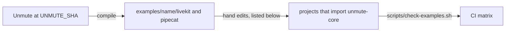

# Example projects

These are six real voice-agent projects that Unmute compiled. Each one installs unmute-core from this repo. Every session that moves code into the library proves it here, in a real project, and not only in unit tests.

Other examples are written by hand. The compile rule below does not apply to them, and `scripts/compile-examples.sh` never touches them:

- `salon-concierge-unmute` is the same salon agent, built directly on the library with no Unmute CLI. It shows how a team with its own orchestrator uses unmute-core. See [salon-concierge-unmute/README.md](salon-concierge-unmute/README.md).
- `parcel-desk` is defined as data instead of code: one dict gives the State as type text, the tasks, the tool options, the greeting and the turn pace. The tools are Python functions, and the model goes through the SLNG Context Router. See [parcel-desk/README.md](parcel-desk/README.md).
- `kestrel`, `wasla`, `nosh` and `faro` are use cases ported from [unmute-beat](https://github.com/slng-ai/unmute-beat), each a different shape of call. They share `voice-stack`, and each runs whole scripted calls on its real model. See [The use-case examples](#the-use-case-examples) below.



1. `scripts/compile-examples.sh` builds Unmute at the commit in `UNMUTE_SHA` and compiles each example.
2. The compiled projects then get hand edits, such as the unmute-core dependency.
3. CI runs `scripts/check-examples.sh` on each project, the hand-written ones too.

## The rule
The examples show what Unmute will emit once it uses unmute-core.

- The raw compiler output is in its own commit: "Add the raw Unmute output for the six example projects".
- Every hand edit after that commit is a change the Unmute compiler must make. List it under "What Unmute must change" below.
- Never edit `package/`. It is Unmute's source, copied as it is.

## The examples

| Example | What it covers |
|---|---|
| `salon-concierge` | Typed state, tasks, task groups, tools, knowledge, Langfuse tracing. Native LLM (Gemini) with SLNG speech-to-text and text-to-speech. |
| `salon-concierge-slng` | The same agent, all on SLNG: the Context Router for the LLM, plus SLNG speech-to-text and text-to-speech. |
| `salon-concierge-single-prompt` | One prompt, typed state filled by prefetch, tools, knowledge, Langfuse tracing. No tasks. It proves the path without tasks. |
| `salon-concierge-unmute` | Hand-written, not compiled. The `salon-concierge` agent on unmute-core directly: one shared package that describes both agents as `AgentSpec`s, plus a LiveKit and a Pipecat project that run them. Two agents with handoffs, tasks in `record` mode, the greeting, call facts and turn pace from the library. |
| `parcel-desk` | Hand-written, not compiled. An agent defined as data, as one `AgentSpec` per call that both frameworks run: the State from type text, Python tools with announce and effect, a group that ends the call, and the SLNG Context Router. |
| `kestrel` | Hand-written. An inbound motor claim: a task group finds the policy, then code asks every question of the report and reads the claim back before filing. See [kestrel/README.md](kestrel/README.md). |
| `wasla` | Hand-written. An outbound payment reminder: the holder is verified before anything about the account is known, and each outcome is read back and recorded on a yes. See [wasla/README.md](wasla/README.md). |
| `nosh` | Hand-written. A restaurant finder with no tasks: three typed tools whose results save values and speak their own line. See [nosh/README.md](nosh/README.md). |
| `faro` | Hand-written. A bilingual language tutor: two agents, one per language, with handoffs; the model grades, code teaches and keeps progress in SQLite. See [faro/README.md](faro/README.md). |
| `minimal` | Hand-written, not compiled. Two small projects, LiveKit and Pipecat, with one file per piece: tools, the SLNG router, telemetry, greeting, idle nudges, handoff and tasks. Each file is a complete agent on a stock framework app. See [minimal/livekit/README.md](minimal/livekit/README.md) and [minimal/pipecat/README.md](minimal/pipecat/README.md). |

Each compiled example has three folders. The hand-written ones keep their own layout, described in their READMEs.

```text
examples/<name>/package/   the Unmute source: agent.yaml, state.py, tools, knowledge
examples/<name>/livekit/   the compiled LiveKit project
examples/<name>/pipecat/   the compiled Pipecat project
```

## The use-case examples

`kestrel`, `wasla`, `nosh` and `faro` follow one layout and one idea: type the agent's path. The model reads what the caller meant and turns it into a typed tool call; code checks it, saves it and says the next line. Most caller turns cost one model request. The docs explain it in "Type the path" (`docs/core/examples/typed-path.mdx`), with one page per example.

```text
examples/<name>/<name>/     the shared package: State, tools, tasks, prompts, and APP
examples/<name>/livekit/    agent.py, about 20 lines over voice_stack.livekit
examples/<name>/pipecat/    bot.py, about 20 lines over voice_stack.pipecat
examples/<name>/scenarios/  whole calls as JSON, run on the real model
examples/voice-stack/       the framework side every use case shares
```

`voice-stack` builds the framework side once: SLNG speech to text (Soniox) and text to speech (Fish Audio) in `eu-north`, Gemini Flash Lite on Vertex AI's `eu` endpoint, the turn pace, the greeting, idle nudges and handoffs. Every default is a field of `voice_stack.StackSettings`, read from the project's `.env`.

Each use case needs `SLNG_API_KEY` and `GOOGLE_API_KEY` (a Vertex AI API key). Run its checks like this:

```bash
cd examples/kestrel/kestrel && uv run pytest                    # tools, words and tasks, offline
scripts/check-examples.sh examples/kestrel/livekit             # imports and one scripted turn, offline
scripts/converse-examples.sh examples/kestrel/livekit          # every scenario, typed caller, real model
scripts/converse-examples.sh --audio examples/kestrel/pipecat  # every scenario, spoken caller, the whole voice pipeline
```

A scenario lists each caller line, the text the agent must say, the most model requests the turn may make, and the state the call must end in. The format is `unmute_core.testing.Scenario`. `--audio` speaks each line with SLNG text to speech and sends it through voice detection, turn detection and speech to text, so it checks the real call. It does not cap model requests: a spoken answer the turn detector splits in two costs one more.

## Where the source comes from
- Unmute commit: `868ae23d543b7704c58b6a538a64ef7ffbbc7691` (the full SHA is in `UNMUTE_SHA`).
- `salon-concierge` and `salon-concierge-single-prompt` come from Unmute's public `examples/` folder. Unmute is MIT licensed. The license is in `LICENSE-unmute`.
- The script clones Unmute into a temporary folder and reads it with `git archive` at that SHA. It never reads a local checkout, because a checkout can hold `.env` files.

### The salon-concierge-slng change
`salon-concierge-slng` is `salon-concierge` with one change in `agent.yaml`, from `salon-concierge-slng.patch`:

```diff
     reasoning:
-      provider: google
-      model: gemini-3.1-flash-lite
+      provider: slng
+      model: gpt-5.6-luna
+      agent_id: salon-concierge-slng-v1
+      upstream:
+        provider: openai
       params:
-        vertexai: true
-        location: eu
-        thinking_config:
-          thinking_level: MINIMAL
+        world_part: eu-north
+        reasoning_effort: "none"
```

- `provider: slng` sends the LLM call through the SLNG Context Router.
- The model is `gpt-5.6-luna`, the alternative that `agent.yaml` already names in a comment. Gemini through the router would need the Vertex upstream and one more credential.
- The Gemini params are removed, because the router would pass them on to OpenAI.
- No new secret is needed. `SLNG_API_KEY` and `OPENAI_API_KEY` are already declared.
- `eu-north` matches the speech-to-text and text-to-speech region.

## How to recompile
Run this when Unmute changes, or to see what the hand edits add:

```bash
scripts/compile-examples.sh --bump    # set UNMUTE_SHA to Unmute's HEAD, then compile
scripts/compile-examples.sh           # or: compile at the SHA already in UNMUTE_SHA
git diff examples/
```

The script replaces each project with raw compiler output. It keeps `.env` and `.venv`. So `git diff examples/` after a recompile shows two things:

1. Changes from a new Unmute SHA.
2. The hand edits, shown as removed. These are exactly what Unmute does not emit yet.

Keep what you need with `git checkout -p examples/`, then lock again in each project with `uv lock`.

The script needs `go`, `uv`, `rsync` and `patch`. It formats with the ruff version that the emitted `pyproject.toml` pins, so the output is the same on every machine.

## How to check
```bash
scripts/check-examples.sh                                  # every project
scripts/check-examples.sh examples/salon-concierge/livekit # one
```

For each project the script does three things:

1. `uv sync --locked` on Python 3.12.
2. Imports every module with an empty environment and no network. Pipecat's `bot.py` is the one exception. It checks its keys and builds the knowledge index at import, on purpose, so a container without keys never reports ready. It may fail there, but never with an `ImportError`.
3. Calls `unmute_core.require()` with this repo's version.

Root `ruff`, `ty` and `pytest` skip `examples/`. Each project keeps the ruff and ty config Unmute emits for it. To lint one:

```bash
cd examples/salon-concierge/livekit && uv run ruff check . && uv run ruff format --check .
```

## Tracing
All three examples set `tracing: provider: langfuse` in `agent.yaml`. So every project sends its call spans to Langfuse when these keys are set:

```bash
LANGFUSE_PUBLIC_KEY=pk-lf-...
LANGFUSE_SECRET_KEY=sk-lf-...
LANGFUSE_BASE_URL=https://cloud.langfuse.com
```

Put the keys in a `.env` file in each project. Start from that project's `.env.example`, which lists every key the project reads. To share one file across all six:

```bash
for p in examples/*/livekit examples/*/pipecat; do cp examples/.env "$p/.env"; done
```

`.env` files are ignored by git, and a recompile keeps them. Tracing starts when a call starts (`setup_tracing()` in `call.py`), not at import. Unmute's text-run scripts do not start it, so you need a real call to see a trace.

## What Unmute must change
These hand edits are in the commit after the raw output. Each one must become compiler output.

1. `requires-python = ">=3.12"` and `[tool.ty.environment] python-version = "3.12"`. unmute-core needs Python 3.12.
2. A dependency on `unmute-core[livekit]` or `unmute-core[pipecat]`. The slng projects also need the `slng` extra.
3. `[tool.uv.sources]` for unmute-core. Here it is a path to this repo. In emitted projects it is not needed: unmute-core comes from PyPI.
4. A `uv.lock`.
5. Pipecat projects pin `pipecat-ai==1.12.0`, not 1.10.0. unmute-core needs Pipecat 1.12.x. In Unmute this is `internal/target/driver.go`, plus its smoke suite on the 1.12.0 wheel.
6. LiveKit projects pin `livekit-agents==1.8.7` and LiveKit plugins `>=1.8.7`, not 1.8.1 (`internal/target/driver.go`). unmute-core needs LiveKit 1.8.7 or newer. LiveKit 1.8.7 needs openai 3, so the slng projects get `openai>=3.19`.
7. SLNG speech sends the agent id and the session id. Each call makes one `slng_session_id` where it begins: in `run_call` on LiveKit, in `_run_bot` on Pipecat. Every `slng.STT`, `slng.TTS`, `SlngSTTService` and `SlngTTSService` gets `external_agent_id` and `external_session_id=slng_session_id`. The agent id is the router's `agent_id` when the package has one, else the package `name`. On Pipecat, `build_stt`, each `build_<agent>_tts` and each agent class take `slng_session_id`. Pipecat projects pin `pipecat-slng>=0.7.0,<0.8`: 0.6 takes no ids. Once the examples import `unmute_core.state`, these become `**tracking_ids(state.call)`.

## Emitted code the library already replaces
These emitted files still carry their own copy of code that unmute-core now has. When a session touches one of these library modules, it switches the examples to import it, and lists the change above.

| Emitted file | Library module |
|---|---|
| `call_state.py` (typed state, prefetch) | `unmute_core.state`, `unmute_core.prefetch` |
| `agents.py` (task prompts and steps) | `unmute_core.tasks` |
| `agents.py` and `tools/` (tool calls) | `unmute_core.tools` |
| `utils/knowledge.py` | `unmute_core.knowledge` |
| `utils/telemetry.py` | `unmute_core.telemetry` |
| `utils/router.py` (slng only) | `unmute_core.slng`, `unmute_core.model` |
| Pipecat `agents.py` (Flows task steps, delegates) | `unmute_core.pipecat` |
| `utils/context.py` (history shaping, summary) and the handoff tools in `agents.py` | `unmute_core.handoff`, `UnmuteAgent.hand_off`, `UnmuteFlows.hand_off` |

To emit imports for the handoff row, Unmute's compiler must:

1. Stop emitting `utils/context.py`. `_last_n`, `_speech_only` and `_summarize` are the library's.
2. Emit each agent as one `AgentSpec`, the same on both frameworks, and each handoff tool as one call: `hand_off(target, announce=..., context=HandoffContext(history=..., max_messages=..., include_tool_calls=...))`. The target is `UnmuteAgent(spec, state=agent.state)` on LiveKit, and the spec itself on Pipecat. A `summarizer:` becomes `AgentSpec(summarizer=...)` with that model as a `ModelCall`.
3. Emit a task's `handoffs:` as `TaskSpec.handoffs`, and drop `_TaskTransfer`, `_claim_terminal` and Pipecat's `_HandoffWorker`.
4. Allow `summary` and `include_tool_calls: false` on Pipecat (`internal/target/table.go`).
