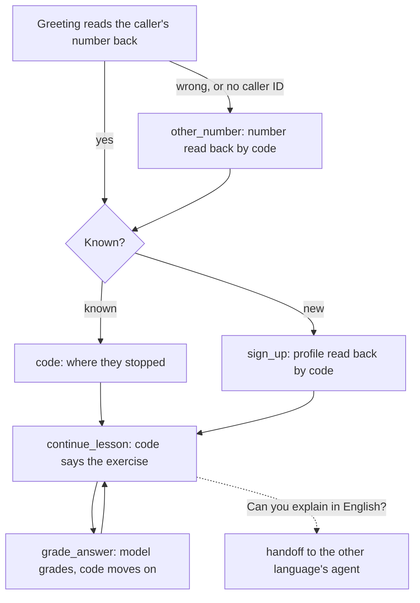

# faro

A bilingual language-learning companion on the phone, built on unmute-core. Faro knows learners by their number, signs new ones up, and teaches short lessons in English or Spanish: it explains in the learner's own language, puts each exercise, judges the answer, and carries on from where they stopped, across calls.

It is a port of `use-cases/faro-language-learning` from [unmute-beat](https://github.com/slng-ai/unmute-beat), without its placement test (a new learner names their level). It runs on LiveKit and Pipecat with the same agents, on the shared EU stack: Soniox and Fish Audio through SLNG in eu-north, and Gemini 3.1 Flash Lite on Vertex AI's EU endpoint.



## Why it is built this way

**Two agents, one per explanation language.** The library says some lines itself: a number read back, a profile read back, a step's first question. A line belongs to an `AgentSpec`, so Faro is `faro_en` and `faro_es`, built from one template, and a learner who asks to switch is handed to the other one. The handoff also saves the new `explanation`, so every line code says from then on is in that language. A known caller is greeted by the agent of their own language, picked before the greeting from their number, with nothing about them said until they say yes.

**The model grades; code teaches.** Every turn of a lesson is one typed decision:

| The learner | The model calls | Code says |
|---|---|---|
| answers the exercise | `grade_answer(answer, grade, feedback)` with a grade of four | the feedback, then the next exercise, the retry, or "Lesson complete" |
| asks for help | `give_hint(hint)` | the hint, and the next right answer counts as practised with help |
| wants to go on | `continue_lesson()` | the exercise, in their language |
| wants a recap | `read_progress()` | what is done, what to review, what is next |
| says something about themselves | `remember(key, text)` | "Noted." |

Code turns the grade into a result, records the attempt in SQLite, moves the learner on or not, and says the next line. The model cannot complete a lesson by saying so: only graded answers move progress, and an answer to an exercise that is not waiting is refused. Nearly every turn costs one model request.

## How the library is used

| unmute-core | Used for |
|---|---|
| Two `AgentSpec`s, `language="en"` and `"es"` | The library's own lines in the learner's language |
| `UnmuteAgent.hand_off`, `UnmuteFlows.hand_off` (through `voice_stack.Handoff`) | Switching language mid-call |
| `Prefetch`: `CallValue` and a `Lookup` | The caller's number, and which language to greet them in, before the greeting |
| `Greeting` with a fallback `instruction` | The number read back; with no caller ID, the model asks for it |
| Main-agent tools with `ToolRegistry(assign=..., replies=...)` | The whole lesson, with no task |
| Locked `{{learner_id}}`, `{{waiting}}`, `{{helped}}` | The model never names the learner or the exercise; a lesson tool before the learner is known is refused |
| `TasksSpec` with `arguments`, `opens_with` and `confirm` | A number the caller says, and a new profile, read back before they are used |
| `Literal` grades and levels, `Phone` | Every value the model sends is typed; a number from outside Spain is refused |

## The learners

The store is `FARO_DB`, or `faro.sqlite3` in the project folder, made with three learners the first time:

| Number | Name | Explains in | Learns | Where they stopped |
|---|---|---|---|---|
| +34 600 111 222 | Lucía | Spanish | English for travel | the second exercise of "ordering at a café" |
| +34 600 333 444 | Diego | Spanish | English for work | the start of "describing a project" |
| +34 600 555 666 | Emma | English | Spanish for daily life | the start of "shopping" |

Any other Spanish number is a new caller.

## Try it

```bash
cd livekit && cp .env.example .env && uv sync && lk agent console agent.py
cd pipecat && cp .env.example .env && uv sync && uv run bot.py -t webrtc
```

Set `UNMUTE_CALL_START={"call": {"direction": "inbound", "calling_number": "+34600555666"}}` to call as Emma, then: "Yes." "Let's carry on." "Un kilo de manzanas, por favor." "¿Cuánto cuesta?" "Quiero pan y leche. ¿Cuánto es en total?"

Also try: a question in the middle of an exercise (a hint, and the next right answer counts as helped), "Can you explain in Spanish?" (the other agent takes over and puts the exercise again), and a new number (a profile, read back, then the first lesson).

## Layout

| Path | What it holds |
|---|---|
| `faro/src/faro/curriculum.py` | The lessons and every line code says, in both languages |
| `faro/src/faro/store.py` | The learners in SQLite |
| `faro/src/faro/desk.py` | The tools |
| `faro/src/faro/state.py` | The call's `State` |
| `faro/src/faro/agent.py` | The two agents, the tasks, the handoffs, and `APP` |
| `faro/src/faro/prompts/` | The shared prompt and each step's |
| `scenarios/*.json` | Whole calls, run live on both frameworks |

## Checks

```bash
cd faro && uv run pytest
cd livekit && FARO_DB=:memory: .venv/bin/python -I -m unmute_core.testing converse livekit agent --patch voice_stack ../scenarios/*.json
cd pipecat && FARO_DB=:memory: .venv/bin/python -I -m unmute_core.testing converse pipecat bot --patch voice_stack ../scenarios/*.json
```
