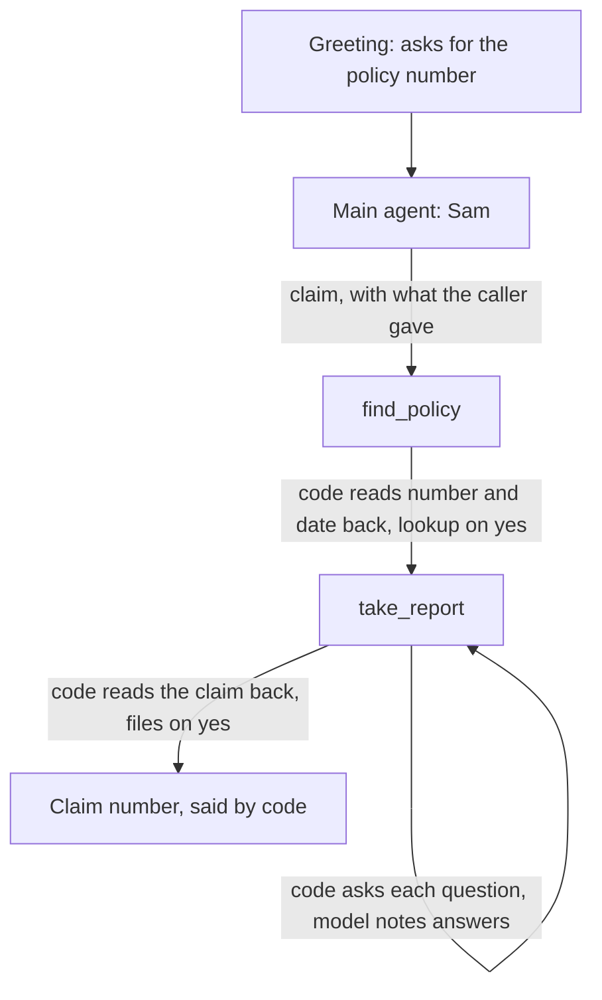

# kestrel

An inbound claims line for a motor insurer, built on unmute-core. Sam answers, finds the caller's policy, takes the report of what happened one question at a time, reads the whole claim back and files it on the caller's yes.

It is a port of `use-cases/kestrel` from [unmute-beat](https://github.com/slng-ai/unmute-beat). It runs on LiveKit and Pipecat with the same agent, and on the EU stack every new example shares: Soniox speech to text and Fish Audio text to speech through SLNG in eu-north, and Gemini 3.1 Flash Lite on Vertex AI's EU endpoint.



## Why it is built this way

Most of what the caller hears is said by code, word for word. The model's job is small: turn what the caller said into typed tool arguments. That is cheaper, and it cannot drift.

| Turn | Who speaks | Model requests |
|---|---|---|
| Greeting | code (`Greeting`) | 0 |
| Policy number and date of birth read back | code (`FinishRule.confirm`) | 1 |
| "Thank you, Daniel, I have your policy." | code (`FinishRule.say`) | 1 |
| Each of the eight report questions | code (`ToolReply` on `note_facts`) | 1 |
| The whole claim read back | code (`confirm` line, from `read_back` in the state) | 2 |
| "Your claim is filed. Your claim number is K C, 1 0 0, 2 3 1. ..." | code (`FinishRule.say`, the number a `Spelled` field) | 1 |

A 13-turn call costs 15 model requests on both frameworks.

## How the library is used

| unmute-core | Used for |
|---|---|
| `CallState` on a Pydantic `State` | Every value typed: `PolicyNumber` (a `Spelled` code, KP and six digits), `BirthDate`, `Policy`, `Report`, the claim number |
| `TasksSpec` in `record` mode, one group | `claim` = `find_policy` then `take_report`, sharing context |
| Group `arguments` + `OpeningTool` | The main agent passes the number and date it heard. When both are known, `find_policy` opens on `lookup_policy` and code reads them back with no model request |
| `FinishRule.confirm` and `say` | The read-backs, and the lines after a lookup and a filing |
| `ToolReply` | The next question after each answer, and the "can't find a policy" line |
| `local_tool` with `locked` | The model never sends the call id, the report or the policy number to `file_claim` |
| `ToolRegistry(assign=...)` on a step's tool | `note_facts` saves the report and its read-back as soon as it returns |
| `Spelled` and `BirthDate` | The policy and claim numbers said a character at a time, and the date of birth with its year, by code |
| Pydantic validators on tool arguments | A future day is refused with words for the caller: "That day hasn't happened yet." |
| `Prefetch` with a `Clock` | Today and the weekday on the London clock, so "yesterday" and "on Monday" become dates |
| `IdleNudges` | A patient nudge for a shaken caller who goes quiet |
| `AgentSpec(language="en-GB", timezone="Europe/London")` | Dates in code's lines named from London's today |

### Two things worth copying

1. **The report is locked, and the read-back follows it.** `file_claim` takes the report and the policy as locked values, and nothing from the model. A correction after the read-back changes the locked report, so the library reads the claim back again before it files anything.
2. **Facts saved as they come.** `note_facts` is a plain function of the report so far and the new facts. Its registry `assign` rows save the merged report and the read-back as soon as it returns, inside the step.

## Layout

| Path | What it holds |
|---|---|
| `kestrel/src/kestrel/state.py` | The call's `State` |
| `kestrel/src/kestrel/claims.py` | The fake claims desk, its tools, the question order and the read-back |
| `kestrel/src/kestrel/words.py` | How codes, days and times are said |
| `kestrel/src/kestrel/agent.py` | The tasks, the greeting, and `APP`, the `VoiceApp` both projects run |
| `kestrel/src/kestrel/prompts/` | Sam's prompt and each step's |
| `livekit/agent.py`, `pipecat/bot.py` | A few lines each, over `voice_stack` |
| `scenarios/*.json` | Whole calls, run live on both frameworks |

## Try it

You need `SLNG_API_KEY` (a key for SLNG's eu-north region) and `GOOGLE_API_KEY` (a Vertex AI API key).

```bash
cd livekit && cp .env.example .env && uv sync
lk agent console agent.py          # talk through your microphone
uv run agent.py dev                # or as a worker for your LiveKit project

cd pipecat && cp .env.example .env && uv sync
uv run bot.py -t webrtc            # then open http://localhost:7860
```

Policies to try: `KP482913`, Daniel, born 5 June 1979, one car. `KP731508`, Priya, born 23 January 1992, two cars.

1. "K P four eight two nine one three." Sam asks the date of birth, then code reads both back.
2. "Yesterday afternoon in the Tesco car park in Leeds, someone scraped my door. Nobody was hurt, no police, the other driver left a note, and it still drives." Code asks only what is missing.
3. "Actually, it was the Fiesta." Code reads the claim back again before anything is filed.

## Checks

```bash
cd kestrel && uv run pytest                          # offline: the desk, the words, the tasks
cd livekit && .venv/bin/python -I ../../../tests/examples/converse_livekit.py agent ../scenarios/*.json
cd pipecat && .venv/bin/python -I ../../../tests/examples/converse_pipecat.py bot ../scenarios/*.json
```

The last two run every scenario as a whole call against the real model, text only, and print the transcript, the tools called and the model requests per turn.
