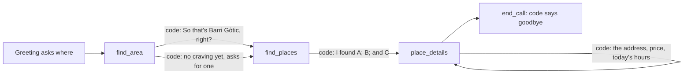

# nosh

An outbound restaurant and bar finder, built on unmute-core. Nosh rings someone who asked for help, finds the area they mean, reads it back, lists places there, and says a picked place's details: where it is, how pricey, and today's hours. It changes nothing anywhere, so nothing needs a yes.

It is a port of `use-cases/nosh` from [unmute-beat](https://github.com/slng-ai/unmute-beat). It runs on LiveKit and Pipecat with the same agent, on the shared EU stack: Soniox and Fish Audio through SLNG in eu-north, and Gemini 3.1 Flash Lite on Vertex AI's EU endpoint.



## Why it is built this way

Nosh is the smallest shape unmute-core supports: **one agent, three tools, no tasks**. It shows that a plain agent gets the same typed path as a task flow, through the tool registry:

1. Each tool's result is a Pydantic model. The registry checks it, then **saves** typed values from it into the call's state (`Assign`): the spot read back, the places on offer, the details said.
2. Each result carries **code's next line**, and the registry speaks it (`ToolReply`). The model is asked for no reply, so every caller turn costs **one model request**: the one that picks the tool.
3. The read-back carries the next step. With no craving and no exact address, `find_area` returns `ask_craving`, and its line asks what they are in the mood for. The caller's yes never makes the model pick a craving. A craving said with the area is saved on the spot, and `find_places` searches for it.
4. Two rules hold in code, not in the prompt. A search runs only on the spot that was read back (`find_places` locks `{{spot}}`). A pick counts only if it was offered (`place_details` locks `{{offer}}` and refuses any other id).
5. Prices and hours are never worded by the model. `speech.py` turns the place service's own fields into words, so nothing is said that the service did not return.
6. The goodbye is the end tool's own line (`announce` with `announce_wait`), said by code.

| Turn | Who speaks | Model requests |
|---|---|---|
| "Hey Maya, it's Nosh! ... Whereabouts are you looking?" | code (`Greeting`, with the dispatch's name) | 0 |
| "So that's Barri Gòtic, Barcelona, Spain, right?" | code (`ToolReply` on `find_area`) | 1 |
| "I found Bar Cañete, a tapas restaurant with ..." | code (`ToolReply` on `find_places`) | 1 |
| "Bar Cañete is on Carrer de la Unió, 17 ..." | code (`ToolReply` on `place_details`) | 1 |
| "What's their number?" | the model, from the saved details | 1 |
| "Enjoy your meal! Bye for now." | code (`end_call`'s announce) | 1 |

## How the library is used

| unmute-core | Used for |
|---|---|
| `CallState(call_start={"customer_name": "required"})` | Who asked for the call, from the dispatch. The greeting and the prompt name them. A dispatch without a name is refused before the greeting |
| `AgentSpec(tools=...)` | An agent with no tasks |
| `ToolRegistry(assign=..., replies=...)` | What each result saves, and the line code says for it |
| `local_tool(..., locked=...)` | `{{spot}}` and `{{offer}}` go to the tools whole, never from the model |
| `ToolError` | An id that was never offered, in words the model acts on |
| `local_tool(..., announce=...)` | A short line while the place service answers |
| `effect="ends_conversation"`, `announce_wait=True` | The goodbye, then the end of the call |

## The place service

Nosh calls four read-only routes of a hosted place service (`TOOLS_URL`, `TOOLS_API_KEY`): `resolve-location`, `search-text`, `search-nearby` and `place-details`. Without `TOOLS_API_KEY` it answers from `DemoPlaces`: a few Barcelona areas (the Gothic Quarter, Gràcia, the Born, Passeig de Sant Joan 55) and places. Sushi finds nothing, on purpose.

## Layout

| Path | What it holds |
|---|---|
| `nosh/src/nosh/state.py` | The call's `State` |
| `nosh/src/nosh/places.py` | The place service client and the demo places |
| `nosh/src/nosh/finder.py` | The three tools |
| `nosh/src/nosh/speech.py` | Ratings, prices, hours and addresses in words |
| `nosh/src/nosh/agent.py` | The registry, the greeting, and `APP` |
| `livekit/agent.py`, `pipecat/bot.py` | A few lines each, over `voice_stack` |
| `scenarios/*.json` | Whole calls, run live on both frameworks |

## Try it

The call must say who asked for it: `.env.example` sets `UNMUTE_CALL_START={"customer_name": "Sam"}`. A real dispatch sends `{"call_start": {"customer_name": "Maya"}}` in the LiveKit job's metadata or the Pipecat runner's request body. Without a name, the call does not start, and the log says `Missing call_start fields: customer_name`.

```bash
cd livekit && cp .env.example .env && uv sync && lk agent console agent.py
cd pipecat && cp .env.example .env && uv sync && uv run bot.py -t webrtc
```

1. "Tapas in the Gothic Quarter, Barcelona." Code reads the area back.
2. "Yes." Code lists three places.
3. "The first one." Code says its address, price and today's hours. "What's their number?"
4. "Actually, what about the Born instead?" A new area takes back the old list.

## Checks

```bash
cd nosh && uv run pytest
cd livekit && .venv/bin/python -I ../../../tests/examples/converse_livekit.py agent ../scenarios/*.json
cd pipecat && .venv/bin/python -I ../../../tests/examples/converse_pipecat.py bot ../scenarios/*.json
```

Every scenario takes one model request per caller turn, on both frameworks.
