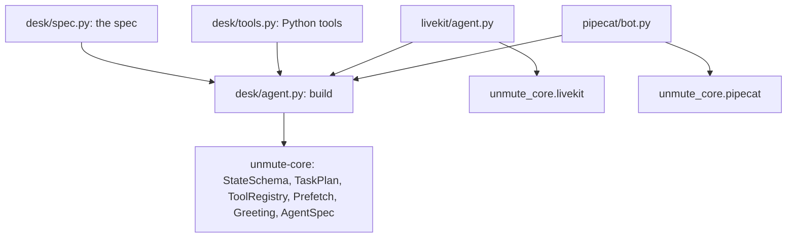

# parcel-desk

A small voice agent defined as data instead of code. The State comes from type text, and the tasks, groups, tool options, greeting, prefetch and turn pace all come from one dict. The tools are plain Python functions. Every model request goes through the SLNG Context Router.

The agent is written once, in `desk/`. `Desk.agent(state)` returns the call's `AgentSpec`: the prompt, the tasks and the router for that call. The LiveKit project runs it with `UnmuteAgent(spec)`, the Pipecat project with `UnmuteFlows(spec, ...)`, and each only builds the pipeline around it.



1. `desk/` imports only unmute-core. It never imports LiveKit or Pipecat.
2. `build()` turns the spec into library objects once per process. A bad row fails there, naming the row, before any call.
3. `Desk.agent(state)` is built per call, after the state, since the router reads `state.call`.
4. `livekit/agent.py` and `pipecat/bot.py` build the session around it, with SLNG speech.

## What the agent does

Parcel Desk answers the phone for a parcel delivery company:

- **track_parcel** finds a parcel by its tracking id and says where it is.
- **move_delivery** is a group: it finds the parcel, then moves its delivery to another day, after the caller confirms the day.
- **request_callback** is a group that takes a note for a person to call back, then ends the call (`then: end`).
- **end_call** is a Python tool whose effect ends the conversation, the same on both frameworks.

Try these tracking ids: `PD-1042` (in transit) and `PD-2077` (held at the depot).

## How the library is used

| unmute-core | Used for |
|---|---|
| `StateSchema` | The State, from type text: `Phone \| None`, `Date \| None`, and a `Parcel` shape with an `Id` and a `Literal` status |
| `local_tool`, `ToolRegistry(state=...)` | The Python tools, with the spec's options. Locked arguments are checked against the State at build time |
| `ToolSpec.announce` | `find_parcel` and `reschedule_delivery` say a line as they start |
| `ToolSpec.effect` | `end_call` ends the call once it succeeds |
| Locked `{{parcel.tracking_id}}` | `reschedule_delivery` reads the parcel from the State. The model never sends it |
| Locked `{{call.session_id}}` | `save_callback_note` reads the call's id from `state.call` |
| `TasksSpec` in `record` mode | The finish check, the confirm line before a write, and the receipt line after it |
| `then: "end"` | `request_callback` ends the call once the note is saved |
| `Prefetch`, `CallValue` | Today on the depot clock, and the caller's number copied from `state.call` |
| `Greeting` | The opening line, checked against what prefetch fills |
| `AgentSpec` | The call's agent: the prompt, the tasks and the router, one description for `UnmuteAgent` and `UnmuteFlows` |
| `RouterModelCall` | The SLNG Context Router, one session per call: `state.call.agent_id` and `state.call.session_id`, the same on both frameworks |
| `sip_call_info`, `telephony_call_info` | What a phone call carries in `state.call`: its numbers and ids. `UNMUTE_CALL_START` simulates a caller in a browser or console |
| `turn_window`, `max_duration` | The spec's turn pace and its longest call |
| `UnmuteFlows.settle` (Pipecat) | Makes the saves a step held, when the caller hangs up |

## Notes

- The tools are Python functions. See `docs/core/build/tools.mdx` for other ways to run tools.
- The depot is in memory and resets on each process start.

## How to run it

You need one key: `SLNG_API_KEY`, for the router and for speech. Langfuse keys are optional.

### LiveKit

```bash
cd livekit
cp .env.example .env              # fill in the key
uv sync
lk agent console agent.py         # talk through your microphone
```

### Pipecat

```bash
cd pipecat
cp .env.example .env              # fill in the key
uv sync
uv run bot.py -t webrtc           # then open http://localhost:7860
```

## Checks

```bash
cd desk && uv run pytest                                  # the spec builds, and the agent does what it says
scripts/check-examples.sh examples/parcel-desk/livekit    # from the repo root
```
