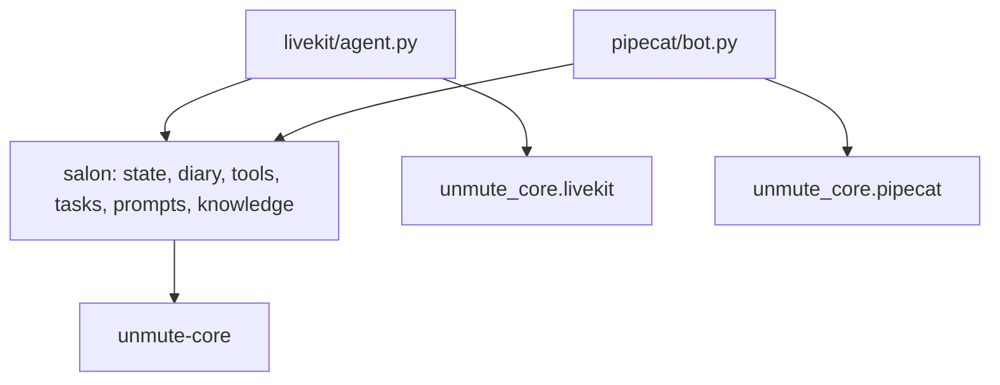

# salon-concierge-unmute

The salon concierge from Unmute's `examples/salon-concierge`, written by hand on unmute-core. No Unmute CLI and no compiler. This is how a team with its own LiveKit or Pipecat orchestrator uses the library.

The agent is written once, in `salon/`. `salon.agents(Salon())` returns both agents as `AgentSpec`s: prompt, tasks, name and timezone. The LiveKit and Pipecat projects run the same specs, and only build the pipeline, the handoff tools and `end_call` around them.



1. `salon/` imports only unmute-core. It never imports LiveKit or Pipecat.
2. `livekit/agent.py` builds an `AgentSession` and an `UnmuteAgent` for each spec.
3. `pipecat/bot.py` builds a pipeline and one `UnmuteFlows`, which starts on the concierge's spec and hands off to the other.
4. Both use the same speech-to-text, LLM and text-to-speech as the original.

## What the agent does

Two agents share one call:

- **concierge** books, moves and cancels appointments, and answers questions about the salon from its guide.
- **complaint_specialist** takes a complaint down and quotes the refund policy.

A handoff tool moves the caller between them. Both read and write one call state.

| Piece | Where |
|---|---|
| Call state (`State`) | `salon/src/salon/state.py` |
| The demo diary (in memory) | `salon/src/salon/store.py` |
| Tools, tasks, knowledge, prefetch, the two `AgentSpec`s | `salon/src/salon/agent.py` |
| Prompts | `salon/src/salon/prompts/` |
| Documents | `salon/src/salon/knowledge/` |

## How to run it

You need three keys: `GOOGLE_API_KEY` (Vertex), `OPENAI_API_KEY` (embeddings) and `SLNG_API_KEY` (speech). Langfuse keys are optional.

### LiveKit

```bash
cd livekit
cp .env.example .env              # fill in the keys
uv sync
lk agent console agent.py         # talk through your microphone
lk agent console --text agent.py  # or type
```

`lk` is the [LiveKit CLI](https://docs.livekit.io/home/cli/). Console mode needs no LiveKit server.

### Pipecat

```bash
cd pipecat
cp .env.example .env              # fill in the keys
uv sync
uv run bot.py -t webrtc           # then open http://localhost:7860
```

### A call to try

1. "I'd like to book a haircut on Friday." The agent checks your number, offers times, confirms and books.
2. "How much is a full head colour?" It answers from the salon guide.
3. "My last colour went wrong, I want to complain." It hands you to the complaint specialist.
4. "Can I also move my haircut to Saturday?" It hands you back to the concierge, who moves it.
5. "That's all, bye." It says goodbye and hangs up.

## How the library is used

| unmute-core | Used for |
|---|---|
| `CallState` | One typed state per call. `customer_phone` stays hidden until the caller confirms it |
| `local_tool`, `ToolRegistry` | The diary methods and the knowledge lookups as tools. `customer_phone` is locked to the state |
| `AgentSpec` | Each agent once, for both frameworks: its prompt, tasks, name and the salon's timezone |
| `TasksSpec`, `TaskPlan` | `verify_customer`, `manage_booking`, and the `book` group, in `record` mode: the finish check and held saves are on |
| `KnowledgeBase` | The services guide and the refund policy, hybrid search |
| `Prefetch`, `CallValue` | Today's date on the salon clock, and the caller's number copied from `state.call` into `customer_phone`, which the caller then confirms |
| `sip_call_info`, `telephony_call_info` | What the call carries in `state.call`: its direction, numbers and ids, from LiveKit's SIP participant or Pipecat's carrier handshake. `UNMUTE_CALL_START` simulates a caller in a browser or console |
| `use_phone_region` | Reads a number said without its country code in the caller's own country |
| `Greeting`, `greet`, `greeting_frames` | The salon's opening line, checked at import against what prefetch fills |
| `max_duration` | Ends the call after 15 minutes |
| `turn_window`, `endpointing`, `vad_params`, `smart_turn_params` | Unmute's `balanced` turn pace on both frameworks |
| `ToolSpec.announce` | `record_complaint` says "Let me get that written down." as it starts |
| `UnmuteFlows.settle` (Pipecat) | Makes the saves a step held, when the caller hangs up. LiveKit does it on its own |
| `Telemetry`, `Langfuse` | One trace per call, when the Langfuse keys are set |
| `UnmuteAgent.hand_off` (LiveKit) | The handoff between the two agents. `to_complaints` says "I'm sorry to hear that. Let me take this down properly." first. The specialist is still Robin to the caller |
| `UnmuteFlows.hand_off` (Pipecat) | The same handoff on Pipecat |
| `TaskSpec.handoffs` | `manage_booking` offers `to_complaints`, as in Unmute's `agent.yaml`. A complaint mid-booking goes straight to the specialist |

## How it differs from Unmute's output

- `to_manager` does not transfer. It tells the caller a transfer needs a phone call. Telephony is not wired here.
- `to_complaints` says a line before the handoff. Unmute's `agent.yaml` has no `announce` on it.
- Both frameworks use the same inactivity nudge text.
- Most caller turns cost one model request. Unmute's output costs two or three on a booking:
  - `book` takes the caller's service, day and intent as typed arguments (group `arguments`).
  - `manage_booking` opens by reading the diary in code (`opens_with`). `find_slots` returns the offer or the cancel read-back as a sentence, and the step says it without asking the model.
  - A save ends on a fixed receipt line (`finish[].say`), so the concierge makes no request to confirm it.
  - The goodbye is said in the same reply as `end_call`, on both frameworks.

## Checks

```bash
cd salon && uv run pytest                                  # the diary rules and the agent definition
scripts/check-examples.sh examples/salon-concierge-unmute/livekit  # from the repo root
```
