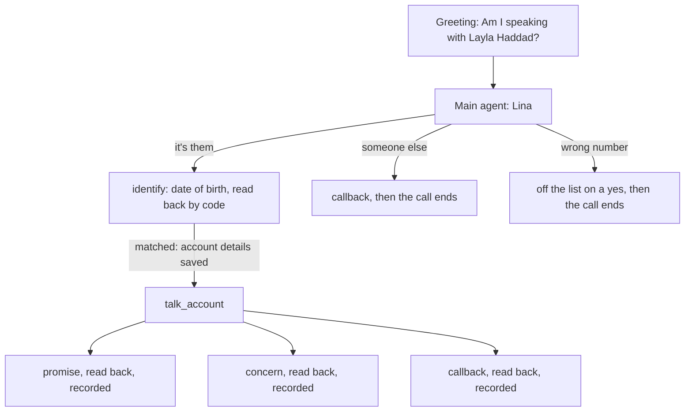

# wasla

An outbound reminder about one overdue buy-now-pay-later payment, built on unmute-core. Lina calls the account holder, checks it is them by their date of birth, says what is overdue, and records one outcome: a promise to pay on a day, a callback, a wrong number, or a concern in the holder's own words.

It is a port of `use-cases/wasla` from [unmute-beat](https://github.com/slng-ai/unmute-beat). It runs on LiveKit and Pipecat with the same agent, on the shared EU stack: Soniox and Fish Audio through SLNG in eu-north, and Gemini 3.1 Flash Lite on Vertex AI's EU endpoint.



## Why it is built this way

This call is about money and a person's credit record, so nothing may be said to the wrong person, and nothing may be recorded that the holder did not hear and agree to.

1. **Nothing about the account before the check.** Only the holder's name is read before the greeting. The amount, the shop and the dates come back from `verify_holder`, and only when the date of birth matched. The `identify` step saves them. Until then every prompt reads them as empty, so a relative who answers cannot hear them, whatever the model does.
2. **Every outcome is read back by code, and recorded on a yes.** `FinishRule.confirm` asks "Shall I record your promise to pay four hundred thirty-four dirhams and fifty fils for Sunday, October 18?" and runs the write only when the caller heard it and said yes.
3. **The rules are types.** A promise or callback day outside today to today plus ten days is refused by the tool's argument type, with the words the agent says: "I can only note a day up to Sunday the 11th of October." A concern is one of four `Literal` kinds, and each kind has its own receipt.
4. **Amounts in words, by code.** The model never turns 434.50 into speech: the ledger returns "four hundred thirty-four dirhams and fifty fils".

A whole promise call costs one model request per caller turn.

## How the library is used

| unmute-core | Used for |
|---|---|
| `CallState` on a Pydantic `State` | The account id, the holder's name, the details saved on a match, and the outcome code |
| `Prefetch` with a `Clock` and a `Lookup` | Today in Dubai, and whose account it is, before the greeting |
| `Greeting` with placeholders | "Am I speaking with {{first_name}} {{last_name}}?", checked at build time against the prefetch |
| `CallState(call_start={"account_id": "required"})` and `save_call_start` | Which account the call is about, from the dispatch's `call_start`. A dispatch with no account, a malformed one (`WA` and four digits) or one the ledger does not hold is refused before the greeting, and the log says why |
| `TasksSpec`, three groups | `account` (identify, then talk_account), `callback` (then the call ends), `wrong_number` (then the call ends) |
| `confirm` on the state | Only the `identify` step confirms the date of birth; `skip_when_confirmed` skips it later in the call |
| `opening: listen` with `announce` | The date-of-birth question is code's, with no model request |
| `FinishRule` per concern kind | One read-back, four receipts, matched on the result's `kind` |
| Group `arguments` + `OpeningTool` | A callback day and time the caller already gave are read back with no model request |
| `then: "end"` | The call ends after a callback or a wrong number, once the receipt has played |
| Locked `{{account_id}}` and `{{call.session_id}}` | The model never names the account or the call a write goes to |

## The account is a required input

An outbound call about nothing must never ring anyone. So `account_id` is a required `call_start` value, typed `WA` and four digits:

| The dispatch sends | What happens |
|---|---|
| `{"account_id": "WA-1001"}` | The call starts. The greeting names Layla Haddad. |
| `{}`, or no `call_start` | Refused: `Missing call_start fields: account_id` |
| `{"account_id": "1001"}` | Refused: `call_start: account_id: String should match pattern ...` |
| `{"account_id": "WA-9999"}` | Refused: `call_start: account_id: no account WA-9999` |

On LiveKit the dispatch sends it in the job's metadata, `{"call_start": {...}}`. On Pipecat it is the runner request's body, or the body of a carrier's handshake. The scenarios check each path: `promise` and `dispute` send a real dispatch, the others use `UNMUTE_CALL_START`, and three scenarios check the refusals.

## Layout

| Path | What it holds |
|---|---|
| `wasla/src/wasla/state.py` | The call's `State` |
| `wasla/src/wasla/ledger.py` | The fake ledger, its tools, and the day window |
| `wasla/src/wasla/words.py` | Amounts, days and times in words |
| `wasla/src/wasla/agent.py` | The tasks, the greeting, and `APP` |
| `wasla/src/wasla/prompts/` | Lina's prompt and each step's |
| `livekit/agent.py`, `pipecat/bot.py` | A few lines each, over `voice_stack` |
| `scenarios/*.json` | Whole calls, run live on both frameworks |

## Try it

You need `SLNG_API_KEY` (eu-north) and `GOOGLE_API_KEY` (a Vertex AI API key). The call must name its account: `.env.example` sets `UNMUTE_CALL_START={"account_id": "WA-1001"}` (Layla Haddad, born 14 March 1990). `{"account_id": "WA-1002"}` is Omar Khalil, born 2 November 1985.

```bash
cd livekit && cp .env.example .env && uv sync && lk agent console agent.py
cd pipecat && cp .env.example .env && uv sync && uv run bot.py -t webrtc
```

1. "Yes, speaking." Then "the fourteenth of March, 1990." Code reads it back.
2. "Yes." "Yes, go ahead." Code says the recording notice and the amount.
3. "Can I pay this Sunday?" Code reads the promise back, and records it on your yes.

Also try: "This is her husband" (nothing about the account is said), "There's no Layla here" (the number comes off the list), "I can pay in three weeks" (refused past the deadline), "I never bought anything from Falcon Electronics" (a dispute, noted in your words).

## Checks

```bash
cd wasla && uv run pytest
cd livekit && .venv/bin/python -I -m unmute_core.testing converse livekit agent --patch voice_stack ../scenarios/*.json
cd pipecat && .venv/bin/python -I -m unmute_core.testing converse pipecat bot --patch voice_stack ../scenarios/*.json
```

## Why the account comes from the check

`CallState(dependencies=...)` could also hide prefetched details until the date of birth is confirmed. Wasla goes one step further: the ledger sends the details only after a matching date of birth, so they are never in the call before the check, whatever the prompt or the model does.
